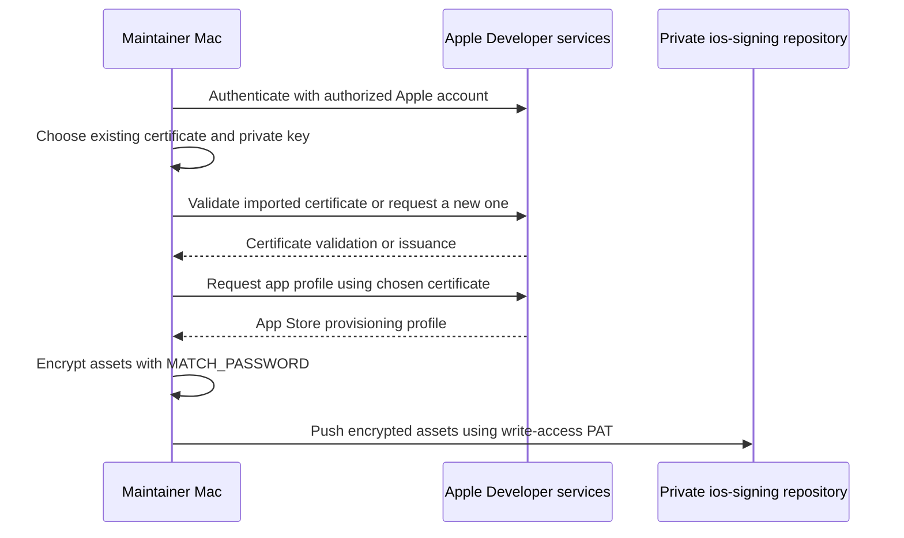
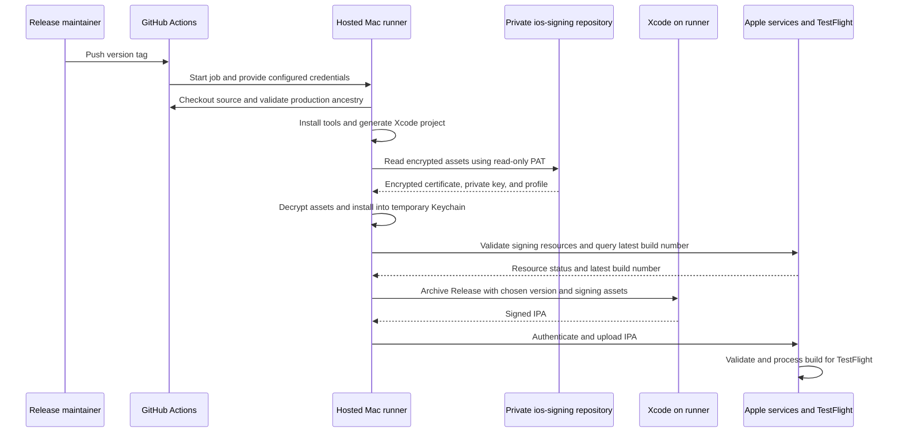

<!-- TestFlightSetup.md — Created by dimaswisodewo on 03/11/2026. -->
# Set up automatic TestFlight uploads

Follow these steps in order. Steps 1–10 are one-time setup; repeat steps 11–12 for releases. Commands run in Terminal on your Mac, from the Itera repository root unless stated otherwise. Replace uppercase placeholders with your own values.

## Why this setup is needed

A TestFlight release has two separate responsibilities: **sign an app that Apple can verify**, then **authenticate permission to upload it to your Apple account**. Your GitHub login alone cannot do either Apple operation. Likewise, logging in to Apple does not give a GitHub runner access to your private signing repository.

GitHub creates a fresh hosted Mac for the job. It does not inherit Xcode settings, Keychain identities, Git credentials, or environment variables from your Mac. We therefore supply the tools and credentials explicitly. Fastlane coordinates the process; match is the Fastlane tool that synchronizes signing assets; Xcode builds and signs the app.

The long part is establishing this reusable setup. Once the assets and secrets are configured, ordinary releases require a reviewed production commit and a version tag. Repeat local signing work when assets expire or change, and update credentials when they expire or are revoked. Coworkers do not need the full release setup merely to contribute code or install TestFlight builds.

### What each credential or identifier does

| Item | Used by / destination | Purpose |
| --- | --- | --- |
| GITHUB_TOKEN | Runner → Itera repository | Automatic job credential for checking out app source; its access does not extend to ios-signing |
| GitHub PAT / MATCH_GIT_BASIC_AUTHORIZATION | match → ios-signing over HTTPS | Reads encrypted signing files; local bootstrap uses separate write access to commit them |
| MATCH_PASSWORD | match on your Mac or runner | Decrypts/encrypts signing files locally; not a GitHub or Apple login password |
| Distribution .cer and matching private key in .p12 | Runner Keychain → Xcode signing | Certificate identifies the signing identity; its private key creates the app signature |
| App Store provisioning profile | Xcode → signed app | Apple-issued authorization connecting the team, app identifier, permitted signing certificate, and capabilities |
| ASC_KEY_ID, ASC_ISSUER_ID, ASC_KEY_BASE64 | Fastlane → Apple services | API authentication for signing-resource checks, querying builds, and TestFlight upload; the .p8 key does not sign the app binary |
| APPLE_TEAM_ID | match and Xcode | Identifies your Apple Developer team; not a password |
| APP_IDENTIFIER | match, Xcode, and App Store Connect | Identifies the app: com.OneDihrection.Itera; not a password |
| Certificate ID | match signing storage and profile creation | Identifies an individual certificate, such as RH2PVS66X5; distinct from the Team ID |

MATCH_GIT_BASIC_AUTHORIZATION and ASC_KEY_BASE64 are encoded for transport, not encrypted by base64. Store them as secrets. The signing repository's files are separately encrypted by match using MATCH_PASSWORD.

### Communication during initial setup



1. The maintainer confirms a valid certificate and matching private key. Existing assets are imported when available; creating a new certificate requires Apple's permission and capacity.
2. Apple supplies the app-specific profile. The certificate can be reused across apps in the team, but the profile must authorize this app and certificate.
3. Match encrypts and pushes the assets. Import and profile synchronization may make separate commits; the diagram summarizes the overall setup.
4. The maintainer configures Actions secrets and variables in Itera. CI subsequently reads the signing repository without creating certificates or profiles.

### Communication during each release



1. The tag triggers the job. GitHub may first queue it until a hosted Mac is available.
2. The workflow checks that the tag has the required version format and its commit belongs to production history. It then installs dependencies and generates the ignored Xcode project.
3. Fastlane's read-only match operation retrieves the existing signing assets. GitHub authentication allows fetching the files; MATCH_PASSWORD allows decrypting them. Neither replaces the other.
4. Fastlane uses Apple API authentication to check signing resources and obtain the latest TestFlight build number. Xcode signs locally using the distribution private key and compatible profile.
5. Fastlane uploads the IPA. Apple validates and processes it afterward. A successful job does not mean it is immediately available to testers; compliance prompts or processing errors can still need attention. Internal groups are configured in App Store Connect; this workflow does not perform external distribution.

The App Store Connect API key and distribution signing private key have different jobs. A valid upload login cannot repair a mismatched profile, and a correctly signed app does not grant permission to upload to an Apple account.

### Where common failures occur

| Error | Stage | Meaning / next check |
| --- | --- | --- |
| Could not locate Gemfile | Local dependency startup | Run from the Itera root containing Gemfile |
| Unable to locate Xcode | Tool selection | Select the full Xcode installation, not only Command Line Tools |
| Waiting for a hosted runner | GitHub scheduling | Build steps have not started; this is before Fastlane |
| Could not read Username; terminal prompts disabled | Signing-repository download | Provide an approved PAT through the local environment or Actions secret |
| Could not create another Distribution certificate | Local signing bootstrap | Inspect existing identities and prefer import; see step 6d |
| Profile doesn't include signing certificate | Xcode archive/signing | Verify the .cer/.p12 pair and profile authorization; see step 6b |
| Upload succeeds but build is unavailable | Apple processing and distribution | Check TestFlight processing, compliance, and group assignment |

Passing one stage only establishes that stage succeeded. For example, Apple login can work while certificate creation is rejected, and match can download a profile that does not authorize the identity Xcode uses.

## 1. Understand the two repositories

You need your existing **Itera app repository** and a separate **private signing repository**, for example `OneDihrection/ios-signing`.

| Location | What belongs there |
| --- | --- |
| Itera repository | App source, project.yml, Gemfile/lockfile, fastlane/Fastfile, and .github/workflows/testflight.yml |
| Private ios-signing repository | Certificates, private signing keys, and provisioning profiles encrypted and committed by match |
| Itera GitHub Actions secrets | Apple API credentials, encoded .p8 key, match password, encoded GitHub read credentials |
| Password manager / secure local storage | Original API key, match password, tokens, and recovery copies |

Do not commit API `.p8` files, tokens, the match password, or unencrypted signing files to either repository. Match encrypts its signing assets before committing them. Base64 encoding alone does not encrypt a secret.

## 2. Prepare your Mac

Install Xcode and open it once to complete component installation and accept its license. In Xcode → Settings → Locations, select its Command Line Tools.

Install Homebrew if needed using its official instructions, then install Ruby 3.3 and XcodeGen:

```sh
brew install ruby@3.3 xcodegen
export PATH="$(brew --prefix ruby@3.3)/bin:$PATH"
gem install bundler
ruby --version
xcodebuild -version
xcodegen --version
bundle install
```

Expected: Ruby 3.3, a selected full Xcode installation, and successful dependency installation. Set the Ruby PATH in your shell configuration if you want it to persist. Commit the existing Gemfile.lock; do not replace it casually during releases.

The repository was previously validated with Xcode 27.1 and XcodeGen 2.45.4. CI uses macos-26 and prints its selected tool versions. Confirm those versions are compatible during the first run; hosted runner defaults can change.

## 3. Prepare your Apple app

You need an active paid Apple Developer membership and access to manage distribution signing.

1. In Apple Developer → Account → Membership details, find your Team ID.
2. In Certificates, Identifiers & Profiles → Identifiers, register or confirm Itera's explicit bundle ID.
3. In App Store Connect → My Apps, create the app record using that same bundle ID, or open its existing record.
4. Confirm required agreements and app information are complete.
5. Confirm project.yml uses the same PRODUCT_BUNDLE_IDENTIFIER and DEVELOPMENT_TEAM. Its current values are `com.OneDihrection.Itera` and `A2WQZ32XVK`; verify ownership before using them.
6. The bundled AppIcon asset set uses the existing hand-hero artwork on an opaque sage background. project.yml selects it through ASSETCATALOG_COMPILER_APPICON_NAME: AppIcon. Regenerate with `xcodegen generate` after changing project settings. Xcode compiles the assets and supplies the primary icon metadata; do not patch Generated/Info.plist manually.

Expected: one consistent bundle ID across Apple, project.yml, and the GitHub variable you will set later. Persistent project changes belong in project.yml, not only the generated Xcode project.

## 4. Create an App Store Connect API key

In App Store Connect → Users and Access → Integrations → App Store Connect API, create a **team API key** with App Manager access. If this area is unavailable, ask your account administrator to enable access or create the key.

Record its **Key ID** and **Issuer ID**, and download its `.p8` file. Apple only allows that download once. Store it outside both repositories, for example in a secure directory in your home folder, and keep a secure backup.

Expected: you have a key ID, issuer UUID, and original `.p8` file. These are separate from your Apple Developer Team ID.

## 5. Create the private signing repository

On GitHub, choose New repository, name it `ios-signing`, and select **Private**. Leave README, license, and .gitignore initialization unchecked. Create the empty repository and copy its HTTPS URL:

```text
https://github.com/OneDihrection/ios-signing.git
```

Match will populate it. Do not upload certificates or keys manually. Match defaults to the signing branch `master`; this is unrelated to the app's `production` branch. The current Fastfile uses that default, so keep it for this setup.

## 6. Reuse or create signing assets with match

Use a **local bootstrap token with write access**. Match must push encrypted files during this step. The separate CI token in step 8 will only read them.

1. Sign in to your personal GitHub account, which must already have write access to `OneDihrection/ios-signing`.
2. Click your avatar → Settings → Developer settings → Personal access tokens → Fine-grained tokens → Generate new token.
3. Name it `Itera signing bootstrap` and choose an expiration date.
4. Select **OneDihrection** as Resource owner, then **Only select repositories** → **ios-signing**.
5. Under Repository permissions, set **Contents: Read and write**. No workflow permission is needed for this signing-only repository.
6. Generate the token and save it securely. If approval is pending, ask a OneDihrection administrator to approve it before continuing. If the organization is unavailable, check membership and organization token policy with its administrator.

A token cannot grant access your account does not already have. Fine-grained tokens also have limitations for outside collaborators; ask the organization administrator to confirm a supported access arrangement if that applies.

In your Mac's default zsh Terminal, enter the token without putting it in shell history:

```sh
read 'signing_user?Your personal GitHub username: '
read -s 'signing_token?Bootstrap token (write access): '
printf '\n'
export MATCH_GIT_BASIC_AUTHORIZATION="$(printf '%s:%s' "$signing_user" "$signing_token" | base64 | tr -d '\n')"
unset signing_user signing_token
export DEVELOPER_DIR=/Applications/Xcode.app/Contents/Developer
```

Use your personal username, not `OneDihrection`. Keep this Terminal open for all commands below. Do not put the token in the Git URL or commit it to a file. The `terminal prompts disabled` error means Git could not obtain credentials; the exported variable avoids an interactive Git login prompt.

### 6a. Choose how to obtain the signing identity

Prefer reuse over creating another certificate:

- **Already stored in match:** if the signing repository has a valid distribution `.cer` and matching `.p12`, go directly to step 6c.
- **Existing certificate with a private key on your Mac:** follow step 6b to import it first. A certificate visible in Apple's portal alone is not enough; its private key is also required.
- **No reusable identity:** coordinate with your team administrator, then run step 6c to let match request a new certificate. Apple must permit certificate creation; the command cannot bypass its restrictions.

A valid distribution certificate can sign multiple apps on the same team. The provisioning profile must cover `com.OneDihrection.Itera`. Do not select a Development, Mac Installer, or cloud-managed certificate for this import path.

### 6b. Import an existing distribution identity

1. Open **Keychain Access → login → My Certificates** and find **Apple Distribution** for team `A2WQZ32XVK`.
2. Expand it and confirm a **private key** appears underneath. Confirm the certificate is unexpired and still active in Apple Developer.
3. Right-click the certificate and choose Export. Select Personal Information Exchange (`.p12`) so the export includes its private key. Save outside both repositories.
4. The current match key-import path expects an empty `.p12` password. Leave the export password empty if permitted. Your Mac login password may separately be requested to authorize the export. If a password is mandatory or your existing `.p12` is password-protected, stop here and resolve export/import compatibility before proceeding; changing MATCH_PASSWORD does not unlock that file.
5. In Apple Developer → Certificates, download the **same certificate** as `.cer`. Match its serial number against Keychain Access, not just its display name.
6. **Verify the certificate fingerprints before importing.** Run these commands on your original local exports, not the encrypted files downloaded from the match repository. Replace the quoted paths with the actual paths to your files:

```sh
openssl x509 -inform DER -in "/path/to/certificate.cer" \
  -noout -fingerprint -sha256
```

```sh
openssl pkcs12 -in "/path/to/exported.p12" -clcerts -nokeys |
  openssl x509 -noout -fingerprint -sha256
```

Enter the `.p12` export password when prompted, or press Enter if it is empty. Neither command prints private keys. If either command fails, resolve that error before comparing results; absent output is not a successful match.

Compare the two SHA256 fingerprints:

- **Identical:** the `.cer` matches the certificate contained in the `.p12`. Also confirm the `.p12` export includes that certificate's private key as described above; the fingerprint comparison alone does not validate private-key contents.
- **Different:** stop. Re-export the identity as `.p12` and the same certificate as DER `.cer` from the same Keychain entry, then repeat the check. Shared display names or matching Team IDs do not establish that they are the same certificate.

7. Once the check passes, run from the Itera root:

```sh
bundle exec fastlane match import \
  --type appstore \
  --git_url https://github.com/OneDihrection/ios-signing.git \
  --team_id A2WQZ32XVK
```

At the prompts, enter the full path to the `.cer`, then the full path to the `.p12`. At **Provisioning profile path**, press Enter to skip if you do not already have a matching App Store profile. Keep certificate validation enabled; do not use skip_certificate_matching to work around a revoked or mismatched certificate.

Follow Apple ID/2FA prompts with an account allowed to manage signing. Apple ID username means the email used for your Apple Developer account. Match validates the certificate against the team, encrypts the files, and commits them to the private signing repository.

When asked for the repository encryption password, use the existing match password or choose and securely save one for initial setup. This is **MATCH_PASSWORD**, separate from any `.p12` export password. Match's encryption protects its Git-stored assets; the empty-password local `.p12` remains sensitive. Keep it in secure storage and remove temporary local exports when no longer needed. Never commit the exports manually.

Expected: encrypted `.cer` and `.p12` files appear under `certs/distribution` on the signing repository's `master` branch. Continue to step 6c to obtain the app's provisioning profile.

#### If a mismatched pair was already imported

Import the corrected, fingerprint-verified pair using the command above. When using the same `.cer`, match replaces the incorrectly paired `.p12` under that certificate ID. Matching filenames in the repository alone do not prove a matching pair: import names the files using the supplied certificate's ID.

Then regenerate the provisioning profile with the corrected identity. Find its ID from the imported filename under `certs/distribution`, without `.cer` or `.p12`. This is the **certificate ID**, not the Team ID:

```sh
bundle exec fastlane match appstore \
  --git_url https://github.com/OneDihrection/ios-signing.git \
  --app_identifier com.OneDihrection.Itera \
  --team_id A2WQZ32XVK \
  --certificate_id YOUR_CORRECT_CERTIFICATE_ID \
  --force
```

Replace the placeholder with the corrected certificate ID. Keep the local write-access PAT available until this completes. `--force` regenerates the provisioning profile using the selected stored certificate. Confirm match pushes the corrected assets, then rerun the failed GitHub Actions job. No certificate revocation is needed to repair a mismatched export.

### 6c. Synchronize signing and create the app profile

From the Itera root, in the same authenticated Terminal:

```sh
bundle exec fastlane match appstore \
  --git_url https://github.com/OneDihrection/ios-signing.git \
  --app_identifier com.OneDihrection.Itera \
  --team_id A2WQZ32XVK
```

Match reuses a valid imported identity, installs it locally, and creates or synchronizes the App Store provisioning profile. If no usable identity exists in its repository, it attempts certificate creation instead. This local operation is writable; CI stays read-only.

If a profile was generated for another bundle ID, it cannot sign Itera under its new identifier. The distribution certificate may still be reused, but obtain the profile for `com.OneDihrection.Itera` through the command above.

Only after import and synchronization finish, clear the Git credential:

```sh
unset MATCH_GIT_BASIC_AUTHORIZATION
```

### 6d. If Apple refuses to create a distribution certificate

For `Could not create another Distribution certificate, reached the maximum number of available Distribution certificates`:

1. Stop retrying creation and confirm the selected Apple team is `A2WQZ32XVK`.
2. Inspect the active regular Distribution certificates in Apple Developer. Revoking Development certificates does not address a distribution-certificate restriction.
3. Prefer step 6b if you or a coworker hold a valid distribution certificate and its private key. Ask the creator for a secure export if the key is on their Mac. Downloading the `.cer` from Apple does not recover the private key.
4. If no reusable private key exists, coordinate with the team administrator to investigate Apple's creation restriction and identify an unused certificate before any revocation. Do not revoke team assets indiscriminately, change managed/Xcode Cloud certificates, or run `match nuke` as a shortcut.
5. If creation is still rejected despite available capacity, retain the preceding Apple error/log details for investigation. Fastlane's maximum-certificates message is a translation of an Apple response, not proof of the precise quota or cause. Suggested GitHub issues are automatic search results.

The internal cert summary may show `force: true`: match sets this when generating a missing certificate/private-key pair. It is expected in that path and does not mean you accidentally enabled a problematic option. Apple login succeeding only confirms authentication, not permission or capacity to create another certificate.

## 7. Check what match stored

Open the signing repository on GitHub and select `master`. Its generated contents should resemble:

```text
certs/
  distribution/
    CERTIFICATE_ID.cer
    CERTIFICATE_ID.p12
profiles/
  appstore/
    AppStore_YOUR_BUNDLE_ID.mobileprovision
```

Names can vary; match may also generate supporting files. The `.cer` is the distribution certificate, `.p12` contains its private signing key, and `.mobileprovision` authorizes signing this app for App Store/TestFlight distribution. These files are encrypted by match in Git storage. You should not manually edit or replace their encrypted bytes.

Expected: match finishes successfully and the encrypted assets appear remotely. Keep the encryption password separately; it must never go in this repository.

## 8. Prepare the CI credentials

Create a **second token** for GitHub Actions; do not reuse the bootstrap write token:

1. Open your personal GitHub Settings → Developer settings → Personal access tokens → Fine-grained tokens → Generate new token.
2. Name it `Itera signing CI` and choose an expiration date you can track.
3. Select **OneDihrection** as Resource owner.
4. Select **Only select repositories** → **ios-signing**.
5. Under Repository permissions, select **Contents: Read-only**.
6. Generate it, complete organization approval if required, and save it securely.

You do not add either token to the signing repository's files or settings. GitHub grants access through the token's repository selection; the encoded CI credential goes into the **Itera app repository's** Actions secret in step 9.

In your Mac's default zsh Terminal, encode the GitHub credentials using hidden input:

```sh
read 'signing_user?GitHub username: '
read -s 'signing_token?Read-only signing token: '
printf '\n'
printf '%s:%s' "$signing_user" "$signing_token" | base64 | tr -d '\n' | pbcopy
unset signing_user signing_token
```

Your clipboard now contains the value for MATCH_GIT_BASIC_AUTHORIZATION. Paste it into the GitHub secret in step 9, then clear the clipboard. Do not paste it into a commit or log.

Encode the original Apple key separately, replacing the path:

```sh
base64 < "$HOME/secure-keys/AuthKey_YOUR_KEY_ID.p8" | tr -d '\n' | pbcopy
```

Paste this clipboard value into ASC_KEY_BASE64 in step 9. Clear the clipboard afterward with `printf '' | pbcopy`.

## 9. Add settings to the Itera repository

Open the **Itera app repository**, not ios-signing. Go to Settings → Secrets and variables → Actions.

Under Variables → New repository variable, add:

| Name | Exact value to supply |
| --- | --- |
| APP_IDENTIFIER | `com.OneDihrection.Itera` (must match project.yml and Apple) |
| APPLE_TEAM_ID | Apple Developer Team ID from step 3 |
| MATCH_GIT_URL | `https://github.com/OneDihrection/ios-signing.git` |

Under Secrets → New repository secret, add:

| Name | Exact value to supply |
| --- | --- |
| ASC_KEY_ID | Key ID from step 4 |
| ASC_ISSUER_ID | Issuer UUID from step 4 |
| ASC_KEY_BASE64 | Encoded contents of the .p8 file from step 8 |
| MATCH_PASSWORD | Encryption password chosen in step 6 |
| MATCH_GIT_BASIC_AUTHORIZATION | Encoded username:read-only-token from step 8 |

For each entry, click New repository secret (or New repository variable), enter the exact name from the table, paste its value, and save. For MATCH_GIT_BASIC_AUTHORIZATION, paste the encoded `username:token` value, not the raw token. The workflow already passes this secret to match; no SSH configuration is needed.

Paste values without surrounding quotes. The workflow's automatically supplied GITHUB_TOKEN reads the app source; it does not grant access to the separate private signing repository.

## 10. Prepare production

Commit and push the app configuration, Fastlane files, lockfile, and workflow through your usual review process. The commit you release must contain these files.

If production does not exist remotely, start from your reviewed release commit:

```sh
git switch -c production YOUR_REVIEWED_COMMIT_SHA
git push -u origin production
```

If production already exists, merge the reviewed setup changes into it through your normal process, then synchronize:

```sh
git fetch origin
git switch production
git pull --ff-only origin production
```

Protect production and restrict creation/update/deletion of `v*` tags to release maintainers using GitHub rulesets. Check that GitHub Actions is enabled for the repository.

## 11. Push a release tag

Choose a new version accepted by App Store Connect. For example:

```sh
git fetch origin
git switch production
git pull --ff-only origin production
git tag -a v1.2.3 -m 'TestFlight 1.2.3'
git push origin v1.2.3
```

Open GitHub → Itera → Actions → TestFlight. The workflow:

1. Validates `vMAJOR.MINOR.PATCH` and confirms the tagged commit belongs to production history. Tags themselves do not belong to branches. Older production commits are eligible too.
2. Installs Ruby dependencies and generates the Xcode project.
3. Reads encrypted signing assets into a temporary CI keychain.
4. Archives scheme Itera in Release for iOS, using the tag as marketing version and the latest TestFlight build number for that version plus one.
5. Uploads the IPA to TestFlight.

Ordinary branch pushes do not upload. Release one tag at a time: GitHub serializes uploads but can replace pending runs if tags arrive rapidly. Other upload systems must not upload concurrently.

## 12. Confirm the build in TestFlight

After the upload succeeds, open App Store Connect → Itera → TestFlight. Apple processing continues after the GitHub job ends. Wait for the build to finish processing and answer any export-compliance questions accurately.

Create or select an internal testing group and add the processed build as needed. This workflow uploads only; it does not submit to the App Store or distribute to external testers. External testing requires its own review and distribution setup.

Expected: the correct version/build appears in TestFlight and becomes available to your selected internal testers. A green archive step alone does not prove Apple accepted the upload.

## 13. Maintain and troubleshoot

| Problem | What to check or do |
| --- | --- |
| Release guard fails | Confirm exact numeric tag format, remote production existence, and that the commit is in its history |
| Signing repository authentication fails | Verify token expiry, organization approval, repository access, and encoded username:token format |
| Decryption fails | Confirm MATCH_PASSWORD matches the password used during bootstrap |
| Profile “doesn’t include signing certificate” | Run the fingerprint check in step 6b. If mismatched, import the corrected pair and regenerate the profile with its certificate ID and --force. If fingerprints already match, inspect the profile and CI-selected signing identity before changing assets |
| Certificate creation reports a maximum reached | Follow step 6d; prefer importing a reusable certificate/private-key pair through step 6b |
| Missing/expired profile or certificate | Run writable match locally with appropriate Apple/GitHub permissions, then retry CI; CI cannot create missing assets |
| Apple authentication fails | Check API key ID, issuer ID, encoded .p8 contents, key role, and revocation status |
| Missing CFBundleIconName (90713) | Confirm the AppIcon asset set and project.yml setting are included in the tagged commit. Merge the fix into production and push a new version tag; rerunning an old tag rebuilds the old configuration |
| Archive or upload fails | Check selected Xcode, bundle/team consistency, app icon, Apple agreements, version restrictions, and export compliance |
| Upload job fails after sending the IPA | Inspect TestFlight first; Apple may already have received it. Wait for processing before retrying |
| Duplicate build number | Wait for Apple's previous upload to become visible. A rerun allocates another number once visible; delayed visibility can cause rejection |

Renew expiring GitHub tokens and update the corresponding encoded secret. Renew signing assets locally through match. Keep the encryption password and original API key in secure backup storage.

For local configuration checks:

```sh
ruby -c fastlane/Fastfile
bundle exec fastlane lanes
xcodegen generate
```

Also build for Simulator with signing disabled before release. No automated test target is introduced. Signed archive/upload, hosted runner compatibility, and physical M1-iPad acceptance remain pending until actually verified; a Simulator build does not establish physical-device acceptance.

## References

- [Fastlane GitHub Actions setup](https://docs.fastlane.tools/best-practices/continuous-integration/github/)
- [Import existing signing assets](https://docs.fastlane.tools/actions/match/#import)
- [match signing and Git storage](https://docs.fastlane.tools/actions/match/)
- [App Store Connect API authentication](https://docs.fastlane.tools/app-store-connect-api/)
- [TestFlight upload options](https://docs.fastlane.tools/actions/upload_to_testflight/)
- [GitHub workflow syntax and tag filters](https://docs.github.com/en/actions/reference/workflows-and-actions/workflow-syntax)

- [GitHub personal access token creation and limitations](https://docs.github.com/en/authentication/keeping-your-account-and-data-secure/managing-your-personal-access-tokens)

The initial AppIcon PNGs were derived on 4 November 2026 from the existing `Itera/Assets.xcassets/hand-hero.imageset/hand-hero.png`, using an opaque sage background. The supplied artwork retains its existing provenance; no new artwork authorship is asserted.
